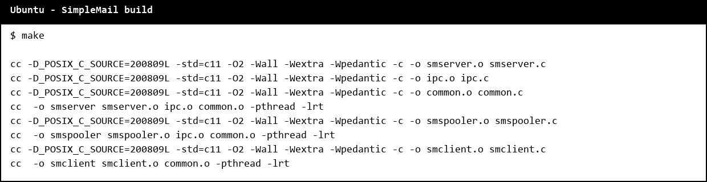
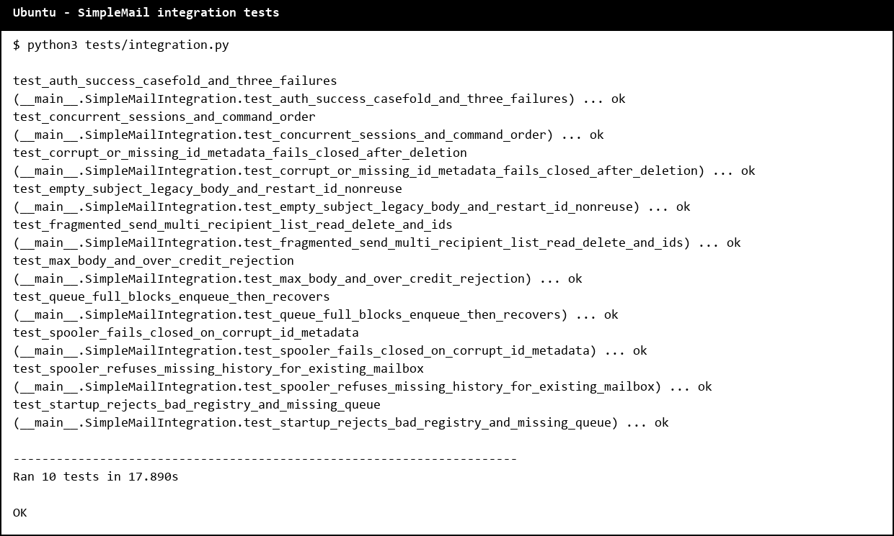
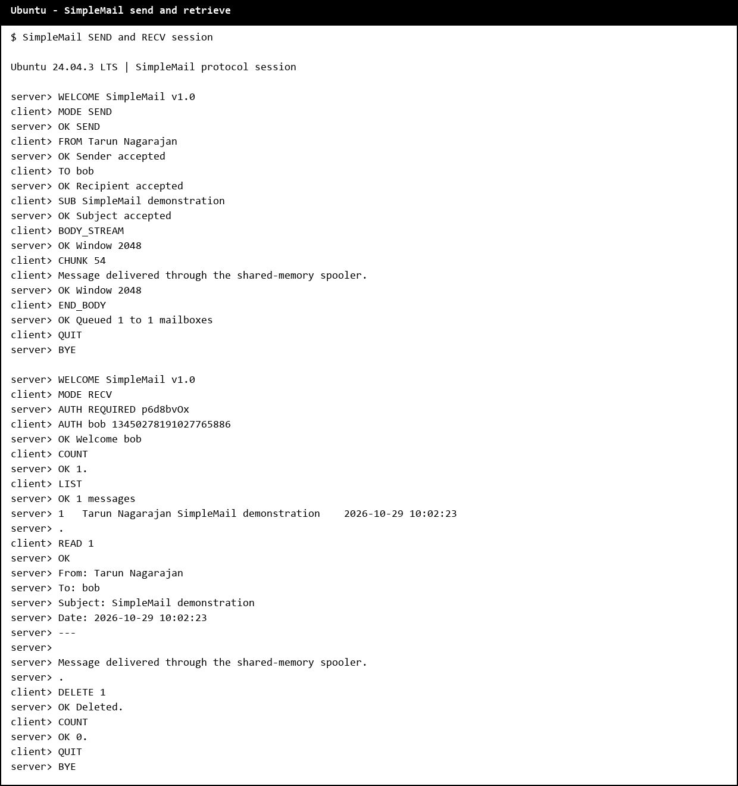

# SimpleMail Technical Guide

Group members: Sumedh Jamadagni (24CSB0A76) and Tarun Nagarajan (24CSB0A79).

## Overview

SimpleMail consists of three POSIX C programs. `smclient` is the interactive terminal interface. `smserver` accepts TCP sessions, checks protocol state, authenticates mailbox readers, and places complete outgoing messages into a process-shared queue. `smspooler` consumes that queue and writes each message into the recipient mailboxes. The spooler creates and writes mail files; the server reads and deletes them for authenticated mailbox sessions.

The programs target a Linux/POSIX environment with POSIX shared memory, process-shared pthread mutexes and condition variables, IPv4/IPv6 client sockets, and `poll()`. The server listens on one IPv4 TCP port and can serve up to 128 active client sessions.

## Build and start

Use the Makefile with a C11 compiler:

```sh
make clean
make
```

The warning flags are `-Wall -Wextra -Wpedantic`. Start the daemons in this order, from the project directory:

```sh
./smspooler users.txt
```

In another terminal:

```sh
./smserver 2525 users.txt
```

Run the client in a third terminal:

```sh
./smclient 127.0.0.1 2525
```

The spooler creates the named shared-memory object `/simplemail_v1_ring`; the server joins it. A server started without an initialized spooler fails after waiting up to five seconds. A second live spooler is rejected. If a spooler has crashed, its stale shared-memory object is removed when a new spooler starts and finds the old owner process is gone. A normal shutdown unlinks the shared-memory object. Stop the server before stopping the spooler so the server does not retain a mapping to a queue with no consumer. A restart begins a fresh queue ticket sequence; mailbox IDs remain durable.

`users.txt` has one `username password` pair per nonblank line. Lines beginning with `#` are ignored. The registry must contain at least one user, at most 128 entries, and no duplicate names ignoring ASCII case. Usernames contain 1-20 ASCII letters. Passwords contain 1-30 ASCII letters or digits. Mailbox directory names use lower-case canonical usernames; passwords preserve case.

## Mailboxes and durable IDs

At spooler startup, `mailboxes/` and a directory for every registered user are created if absent. A delivered message is stored as `mailboxes/<canonical-user>/<id>.txt`. Each file contains:

```text
From: <display name>
To: <comma-separated accepted recipients>
Subject: <subject or (no subject)>
Date: <YYYY-MM-DD HH:MM:SS>
---

<body bytes>
```

Each mailbox's hidden `.next-id` file holds its next ID. The spooler writes the incremented value to a temporary file, flushes it, calls `fsync()`, renames it into place, then synchronizes the mailbox directory before creating the message file. A crash can therefore skip an ID, but cannot cause an already allocated ID to be reused. Missing metadata is initialized to 1 only for a mailbox directory created by that spooler startup and still empty. If an existing mailbox has missing, malformed, unreadable, or unusable metadata, startup or delivery fails closed; it never reconstructs history from the message files. This is deliberate because deleted messages may have contained a higher ID than any file left behind. Deletion removes the message file but does not change `.next-id`.

The display name is accepted as text after `FROM`, up to 128 bytes. Recipient names must match the registry and are canonicalized. Subjects are limited to 512 bytes. Empty subjects are stored as `(no subject)`. Bodies are at most 65,536 bytes.

## Shared-memory queue and synchronization

The shared object contains a fixed ring of eight complete `SmMessage` records. Each record carries a process-local monotonic ticket, display name, up to sixteen recipient names, subject, body length, and a fixed 65,536-byte body buffer. The shared structure also holds the owner PID, version magic, ring head/tail/count, next ticket, and number of freed slots.

One `PTHREAD_PROCESS_SHARED` mutex guards the queue count, head, tail, ticket counter, generation, and record publication. A process-shared `not_empty` condition wakes the spooler when the server enqueues a record. A process-shared `not_full` condition is signaled as the spooler pops a record. Server-side queue insertion is nonblocking: if the ring is full, the completed message stays in that client's bounded connection state, and the poll loop retries it after capacity becomes available. This keeps unrelated sessions responsive while one sender waits.

The spooler validates each queued recipient against its startup registry, then persists one copy for each accepted recipient. It logs each dequeue and each recipient delivery or failure. Tickets increase within one spooler lifetime and restart from 1 after a fresh shared queue is initialized; durable mailbox IDs do not reset.

## Concurrency and TCP framing

The listener and accepted server sockets are nonblocking. `poll()` watches the listener and all active sessions. Each session retains its own input buffer, output buffer, protocol state, staging record, and challenge nonce. Output is queued and sent as the socket becomes writable. This allows greetings, command lines, raw chunk headers and data, and pipelined commands to arrive split across or combined into arbitrary TCP reads.

Command lines use CRLF and may occupy at most 512 bytes including the terminator. The server keeps incomplete lines buffered until CRLF arrives and rejects overlong lines. A new connection receives `WELCOME SimpleMail v1.0`; it must select `MODE SEND` or `MODE RECV` within 30 seconds. Invalid mode handshakes are answered with an error and closed. Significant server and spooler events are written to stdout with the exact timestamp prefix `[YYYY-MM-DD HH:MM:SS]`.

## SMTP2 sending protocol

The send mode accepts a strict transaction sequence:

```text
FROM <display name>
TO <registered user>
TO <another registered user>
SUB <subject text>
BODY_STREAM
CHUNK <byte_count>
<exactly byte_count raw bytes>
END_BODY
```

At least one valid `TO` is required. Each chunk header is a CRLF line, followed immediately by exactly the announced number of raw bytes. The client may split a chunk across TCP packets; the server waits for all announced bytes before acknowledging it. `END_BODY` enqueues the complete message and returns `OK Queued <ticket> to <recipient_count> mailboxes`. `QUIT` returns `BYE`; after a queued transaction the sender may begin another with `FROM`.

Legacy clients may choose `BODY` instead. The server then reads text through the `CRLF.CRLF` terminator and removes one dot from every dot-stuffed line. In both modes, a body larger than 65,536 bytes is rejected. If there are no recipients accepted or a command arrives out of sequence, the server reports a protocol error.

### Byte-credit accounting

The streaming byte window and the ring's eight message slots are distinct resources. `BODY_STREAM` starts with 2,048 bytes of client input-window credit and replies `OK Window 2048`. A sender must not send a `CHUNK` larger than its current credit; otherwise the server responds `ERR Window overflow` and closes that connection. After a complete chunk is copied into the bounded per-client body record and removed from the network input buffer, those consumed bytes are returned in `OK Window <remaining_window_bytes>`. This immediate acknowledgement replenishment lets a first 65,536-byte message progress even when the ring is empty, without waiting for an unrelated message to be dequeued.

Separately, each actual ring-slot dequeue creates up to 2,048 additional credits for every active stream, reported asynchronously as `WINDOW_UPDATE <additional_credits>`. Credits are capped at 65,536 per stream, and only an observed dequeue can trigger this update. When a complete message is waiting for a full ring, it remains in that connection's staging state until a real slot is free; no client is promised a queue slot early. The body-length check remains independently capped at 65,536 bytes.

## SMP mailbox protocol

After `MODE RECV`, the server replies `AUTH REQUIRED <eight-character nonce>`. The client sends `AUTH <username> <decimal hash>`, where the hash is unsigned-long DJB2 over the password concatenated directly with the nonce. A successful login returns `OK Welcome <canonical_username>`. Two invalid attempts return `ERR Authentication failed`; the third returns `ERR Too many failures` and closes the connection. Nonces use the system random source (`getrandom()` with `/dev/urandom` fallback).

Authenticated commands are:

| Command | Response |
| --- | --- |
| `LIST` | `OK <count> messages`, then tab-separated `<id>`, display name, subject, and date rows, then `.` |
| `READ <id>` | `OK`, then the stored headers and body; the body is dot-stuffed and followed by `.` |
| `DELETE <id>` | `OK Deleted.` when the file is removed |
| `COUNT` | `OK <count>.` |
| `QUIT` | `BYE`, then close |

Unknown commands return `ERR Unknown command.`. The mailbox client can log out and return to the main menu; it opens a fresh TCP connection for each SEND or RECV choice because a connection selects one mode.

## Compatibility assumptions

Protocol command text and stored headers use ASCII-compatible single-byte text. Bodies are raw bytes, although the interactive client accepts terminal text. The DJB2 value is formatted as an unsigned decimal `unsigned long`; client and server must use the same ABI width and byte interpretation. The intended environment is the same Linux/POSIX host for both daemons, so the shared-memory structure is native-layout and is not an inter-machine wire format. Local timestamps use the host's local timezone. Ticket numbers are volatile across spooler restarts; message IDs are durable across deletion and restart.

## Local verification

Build and run the local integration suite with:

```sh
make clean
make
make test
```

The suite launches the real binaries in temporary local directories. It covers registry/startup failures, both modes, fragmented command frames, send ordering, multiple recipients and concurrent sessions, stream and legacy bodies, dot stuffing, full-size bodies, over-credit rejection, queue-full recovery and `WINDOW_UPDATE`, mailbox LIST/READ/DELETE/COUNT, successful and three-failure authentication, and non-reused mailbox IDs after deletion and daemon restart. It uses no external services and does not publish or push the tests.

## Ubuntu execution output

The following terminal-style images reproduce captured output from Ubuntu 24.04.3 LTS (x86_64, GCC 13.3.0). They are rendered transcripts, rather than desktop captures. The relocated project built without warnings and all 10 integration tests passed. The tests remain local and are excluded from GitHub.






