# SimpleMail, Documentation.

Group Details:

Member 1: Sumedh Jamadagni, 24CSB0A76

Member 2: Tarun Nagarajan 24CSB0A79

## Purpose and architecture

This document covers the components and behavior required by the Computer Networking Programming Assignment. SimpleMail consists of `smserver`, `smspooler`, and `smclient`. The client and server use TCP; the server and spooler exchange complete messages through a shared-memory ring. Only the spooler creates and writes mail files. The authenticated server reads or deletes files for SMP mailbox operations.

The server uses nonblocking sockets and `poll()` to serve up to 128 clients on one configurable port. Each connection owns an input buffer, output buffer, protocol state, nonce, and bounded message staging record. Partial TCP reads are retained until a complete command or chunk arrives; partial writes remain queued. A waiting sender does not block other clients.

## Build, startup and user registry

Build on Ubuntu/Linux with a C11 compiler, Make, POSIX shared memory, sockets and pthread support:

```sh
make clean
make
```

The Makefile builds all three programs with `-Wall -Wextra -Wpedantic` and links pthread/real-time support. Start the following in separate terminals, from the same project directory:

```sh
./smspooler users.txt
./smserver 2525 users.txt
./smclient 127.0.0.1 2525
```

Both daemons load the user registry at startup. Use one username/password pair per line, separated by a space. Usernames are ASCII letters, at most 20 characters, and are compared without case; mailbox paths use lowercase names. Passwords are case-sensitive ASCII alphanumeric strings, at most 30 characters. Duplicate usernames and invalid or missing registries cause startup failure. The parser also permits blank lines and comment lines beginning with `#`.

The sample users are `alice password1`, `bob secret2`, and `carol hunter7`. The implementation supports 128 registry entries. Passwords in this registry and the required DJB2 challenge mechanism follow the assignment's format.

Start the spooler before the server; the server waits up to five seconds for its shared object. A second live spooler is rejected. After a crash, a replacement spooler can remove a stale shared object whose owner is no longer alive. Stop the server before the spooler; the server must not continue using a queue without its consumer.

## Shared-memory spool and synchronization

The POSIX object `/simplemail_v1_ring` contains eight fixed-capacity message slots. Each record holds the sender display name, accepted recipients and count, subject, body length, a 65,536-byte body buffer, and queue ticket. The queue header contains the owner PID, initialization magic, head/tail/count, ticket counter and a dequeue generation counter.

A process-shared pthread mutex protects record publication, indexes and counters. Process-shared `not_empty` and `not_full` conditions coordinate queue availability. These implement the assignment's permitted mutex/condition-variable alternative to unnamed semaphores. The spooler waits for records and releases queue capacity after dequeue. The frontend attempts insertion without waiting in the event loop; a completed message remains in its connection state until a slot is available.

The server assigns increasing queue tickets while the shared queue exists. The spooler validates each queued recipient and writes a copy to every accepted recipient. A fresh spooler run resets the queue ticket sequence; mailbox IDs are separate, durable counters. Queue contents are volatile, so `OK Queued` confirms acceptance into shared memory rather than completed disk persistence.

## Mailbox files and IDs

At startup the spooler creates `mailboxes/` and one directory for every registered user. Each mail is a separate `<id>.txt` file. The stored format is:

```text
From: <display name>
To: <comma-separated accepted recipients>
Subject: <subject or (no subject)>
Date: <YYYY-MM-DD HH:MM:SS>
---

<body>
```

Each mailbox's `.next-id` metadata starts at 1. The spooler reserves the next ID using a temporary metadata file, flushes and synchronizes it, renames it, and synchronizes the directory before creating the mail. A crash may skip an ID, but deletion and normal restart do not reuse it. A newly created empty mailbox can initialize metadata; an existing mailbox with missing or malformed metadata fails closed. The spooler does not reconstruct deletion history from remaining files.

## Connection handshake and SMTP2

A new connection receives `WELCOME SimpleMail v1.0`. `MODE SEND` or `MODE RECV` receives `OK`; RECV then receives its authentication challenge. An invalid mode receives `ERR Unknown mode` and closes. A connection that sends no mode is closed after 30 seconds.

SMTP2 commands and responses end with CRLF. Command lines are limited to 512 bytes including CRLF. Sending requires no authentication; FROM carries a display name, rather than a registered account. The implementation permits 128-byte display names, up to 16 accepted recipients, and printable header text.

| Command or state | Required behavior |
| --- | --- |
| FROM <display name> | Start a transaction; reply `OK Sender accepted.` |
| TO <username> | Accept registered recipients with `OK Recipient accepted.`; unknown users receive `ERR No such user.` |
| SUB <subject> | Require at least one accepted recipient; reply `OK Subject accepted.`; empty text is stored as `(no subject)`. |
| BODY_STREAM | Enter chunked body input; initially reply `OK Window 2048`. |
| CHUNK <byte_count> | Read exactly that many raw bytes after the header's CRLF; acknowledge the remaining window. |
| END_BODY | Queue the complete message, then reply `OK Queued <ticket> to N mailboxes`. |
| BODY | Reply `OK Send body, end with CRLF.CRLF.` and accept legacy dot-terminated input. |
| QUIT | Reply `BYE` and close after completing the transaction. |

Out-of-sequence commands receive `ERR Bad sequence`. After a queued message, another FROM can start the next transaction on the same sending connection. Unknown recipients do not prevent subsequent valid TO commands. The client must receive at least one acceptance before proceeding to SUB.

In BODY_STREAM, byte counts frame the payload; raw data may contain line breaks and may arrive in several TCP reads. No extra separator is inserted between a chunk's raw bytes and the next command. In BODY, a line containing only `.` terminates input, including an empty body. A sender adds a dot to a body line that already starts with one; the server removes this extra dot. The combined body limit is 65,536 bytes in either mode; exceeding it returns `ERR Body too large.`.

### Byte credits and backpressure

The byte window and the ring's message-slot count are different resources. Each complete chunk consumes credits and receives `OK Window <remaining>`. Consumed bytes move into the connection's bounded body record and become pending for credit restoration. A later `WINDOW_UPDATE <additional_credits>` restores those bytes when the spool queue has available capacity. This allows a first large upload to progress without an unrelated prior message.

When the ring is full, credit restoration waits. A sender that consumes its initial 2,048 bytes can therefore receive `OK Window 0` and must pause. The poll loop continues serving other clients. Once the spooler drains the ring, credit updates and waiting queue confirmations resume. Sending a chunk larger than the advertised balance, including any positive chunk at zero credits, returns `ERR Window overflow` and closes the connection. Each body remains bounded independently at 65,536 bytes.

## SMP authentication and mailbox operations

After RECV selection, the server sends `AUTH REQUIRED <nonce>`, using eight random alphanumeric characters. The client hashes password followed by nonce, with no separator, using the assignment's DJB2 algorithm, and sends `AUTH <username> <unsigned-decimal hash>`. Successful authentication returns `OK Welcome <canonical username>`. Failed attempts receive `ERR Authentication failed`; the third receives `ERR Too many failures` and closes the connection.

| Authenticated command | Response |
| --- | --- |
| LIST | `OK <count> messages`, then tab-separated ID, sender display name, subject and date rows; end with a single `.` line. |
| READ <id> | `OK`, followed by the mail headers/body, with dot-stuffing for body lines beginning with `.`; end with a single `.` line. |
| DELETE <id> | Remove that user's file and reply `OK Deleted.`; retain ID history. |
| COUNT | `OK <count>.` |
| QUIT | `BYE`, then close. |
| Unrecognized command | `ERR Unknown command.` |

Missing READ/DELETE targets receive an error and leave the mailbox unchanged. Authentication fixes the mailbox identity for the session; IDs are interpreted within that user's directory. Client and server must use the same unsigned-long ABI width for DJB2. Command/header text is ASCII-compatible; streamed bodies are raw bytes. Dates and daemon logs use the Ubuntu host's local timezone.

## Interactive client and event logs

`smclient <server_ip> <port>` provides the required numbered menu: 1 sends, 2 checks a mailbox, and 3 quits. Sending prompts for display name, recipients, subject and body; a blank recipient finishes the list, and a single-dot body line finishes terminal entry. The client handles chunks, credits and asynchronous updates. Mailbox commands provide list, read, delete, count and logout. Logout returns to the main menu using a fresh connection for the next mode. Retrieval removes transport dot-stuffing before displaying the body.

Both daemons write significant events to stdout with `[YYYY-MM-DD HH:MM:SS]` prefixes. Server events cover connection, mode, authentication, queue insertion, mailbox access and disconnection. Spooler events cover dequeue and per-recipient delivery or failure. These logs distinguish queue acceptance from later file delivery.

## Verification and troubleshooting

The current source builds without warnings on Ubuntu 24.04.3 LTS, x86_64, GCC 13.3.0. Ten integration tests cover protocol, storage, concurrency and failure handling. Further scenario runs below force the assignment's boundary and recovery conditions, including an actual 30-second idle timeout, a stopped consumer, zero credits, and twenty simultaneous senders. The real interactive client is also exercised. Test scripts and capture drivers remain local; captured output is included in the documentation.

If the shared queue cannot be opened, start the spooler first. If binding fails, use a free port. For registry errors, correct the characters, lengths or duplicate name. For authentication failure, check password case and hash the password before the current nonce. For an unsafe ID counter, preserve the mailbox and restore valid metadata instead of resetting the number. For delayed sending with a full queue, inspect the spooler and delivery logs; queue confirmations and credit restoration wait for consumer capacity.

## Ubuntu execution output

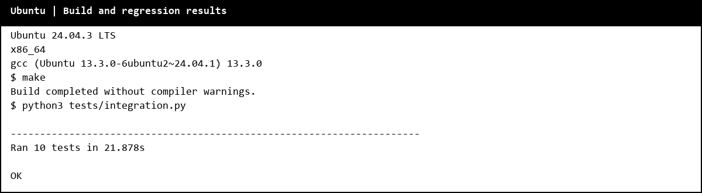

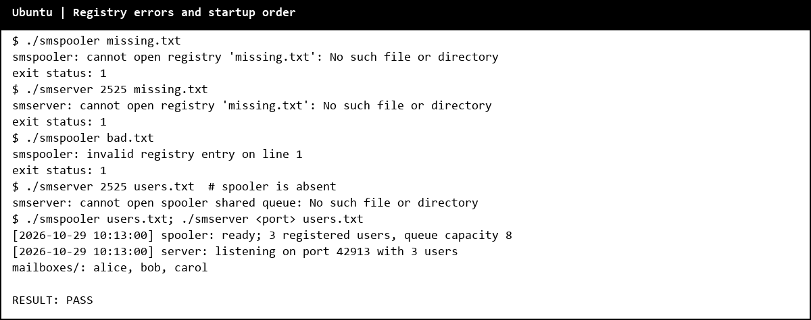

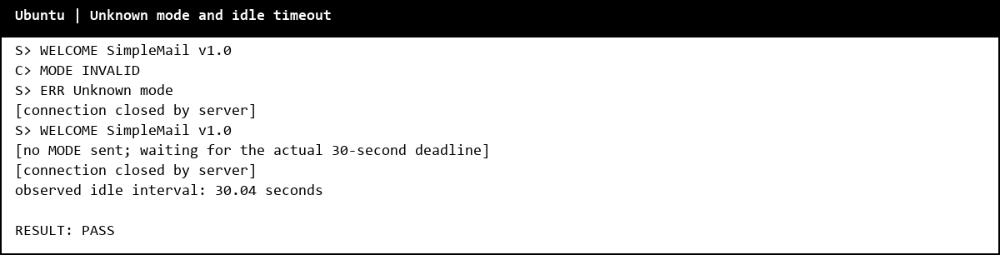

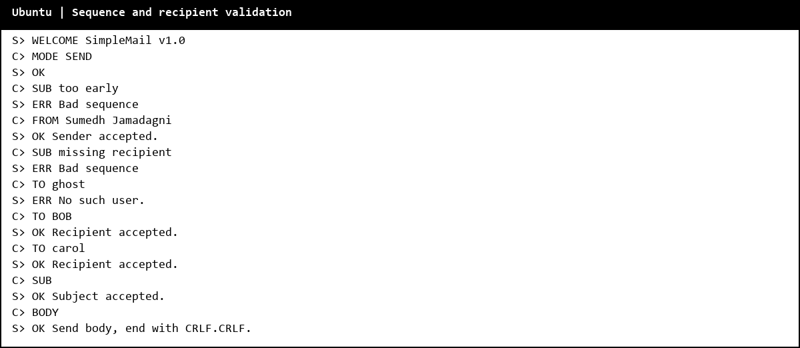

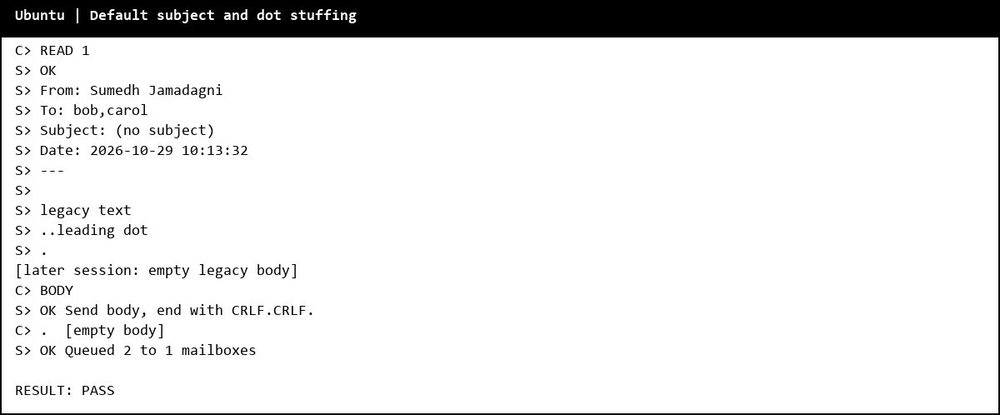

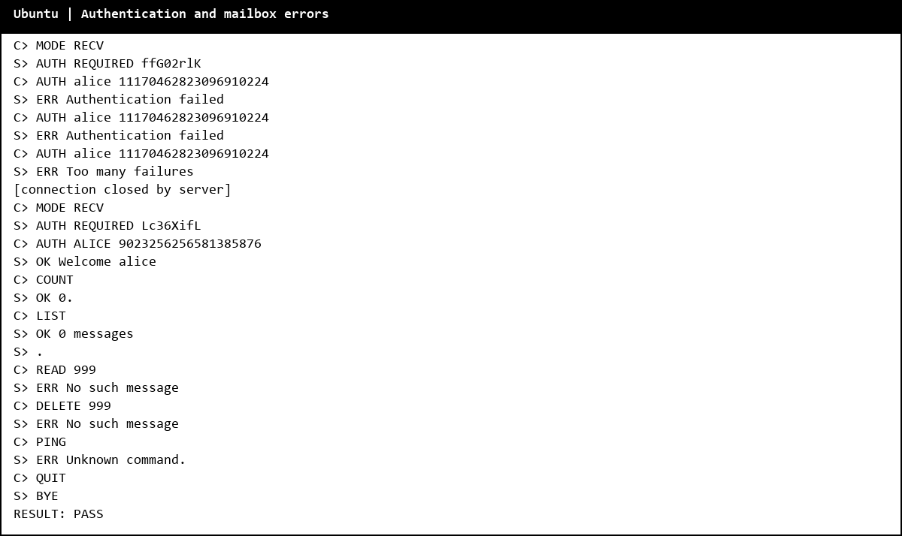

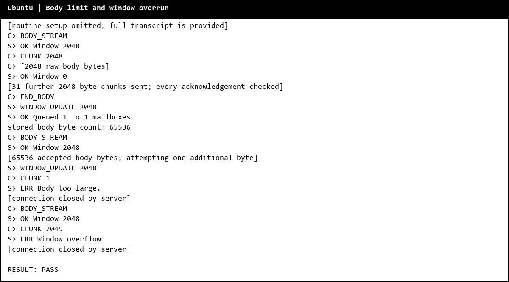

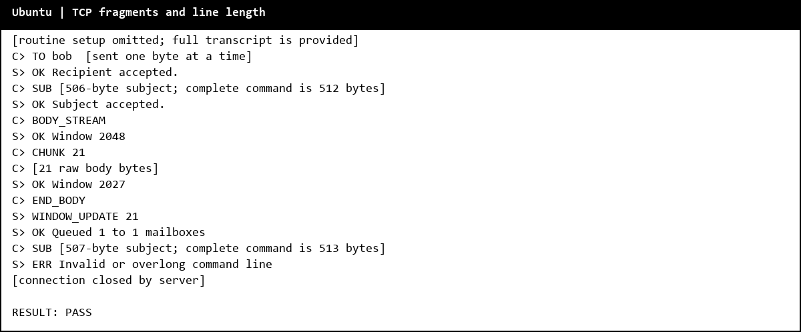

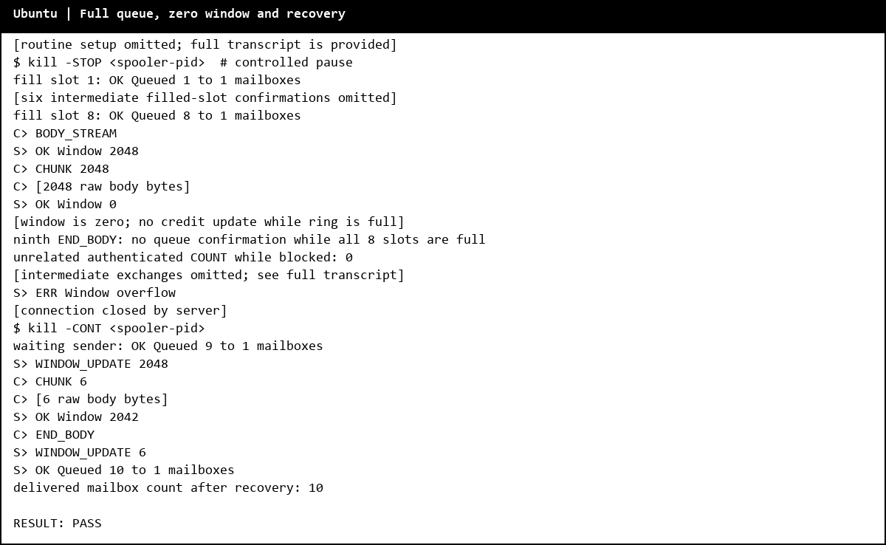

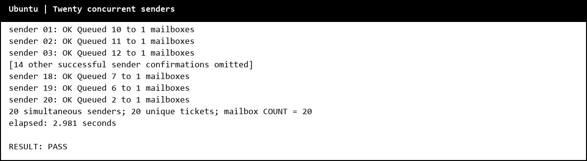

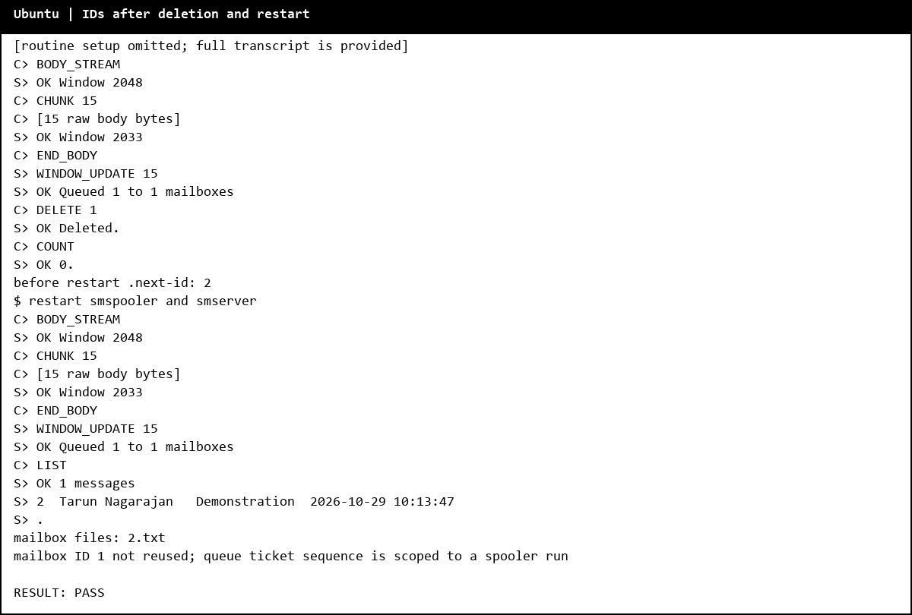

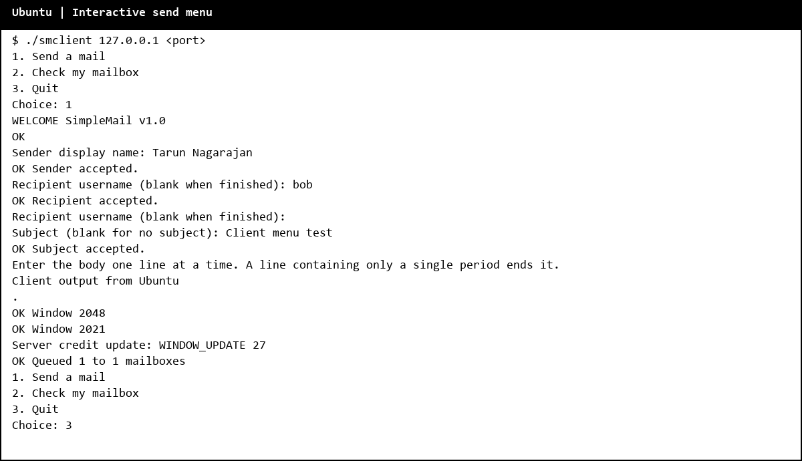

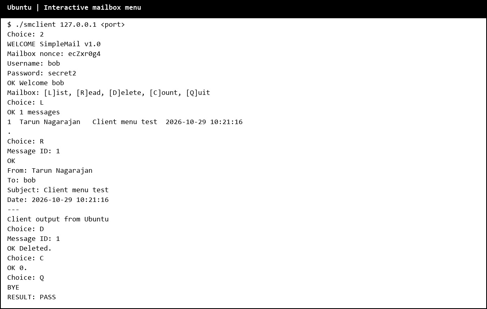

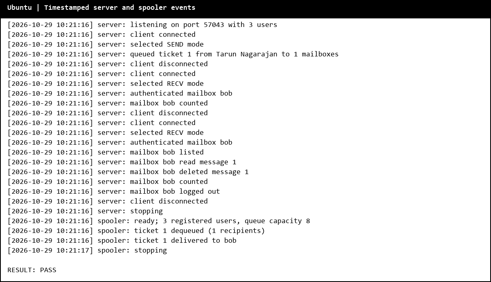
